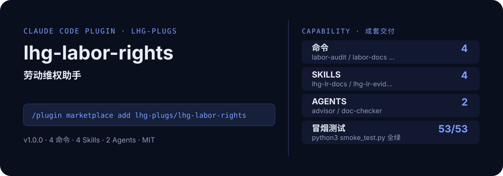

<!-- About 简介（推送后填写到仓库 About 栏）：
劳动维权助手：纠纷场景判定→仲裁/诉讼流程指引→仲裁申请书与证据清单模板→证据三要素体检；非律师意见、仅供参考，时效与管辖等关键问题请咨询执业律师。 ｜ 一键安装：/plugin marketplace add lhg-plugs/lhg-labor-rights
-->
<!-- topics（推送后打）：claude-code, claude-plugin, agent-skills, labor-rights, labor-arbitration, legal-aid, evidence, document-template -->

<p align="center">
  
</p>

> **一句话介绍**：劳动维权助手：纠纷场景判定→仲裁/诉讼流程指引→仲裁申请书与证据清单模板→证据三要素体检；非律师意见、仅供参考，时效与管辖等关键问题请咨询执业律师。

**一键安装**：在 Claude Code 里运行

```bash
/plugin marketplace add lhg-plugs/lhg-labor-rights
/plugin install lhg-labor-rights@lhg-plugs
```

## 它能帮你做出什么

- **冒烟全绿**：`python3 smoke_test.py` 53 项全部通过（JSON 合法、frontmatter 完整、命令/skill/agent 齐全）。

## 它是什么

`lhg-labor-rights` 是一个 Claude Code 插件（plugin 为主、skill 为辅）：

- **4 个命令**（小白入口）：`labor-audit` 维权文书体检、`labor-docs` 起草仲裁申请书、`labor-evidence` 整理证据清单、`labor-rights` 劳动维权一条龙
- **4 个平台中立 skill**（方法论，可移植到豆包/Workbuddy 等 agent 平台）：lhg-lr-docs, lhg-lr-evidence, lhg-lr-process, lhg-lr-scenario
- **2 个专家 agent**：advisor, doc-checker
- **1 个 hooks**（`hooks/`：pre_lawyer_gate.py），关键操作前自动把关

## 为什么是它

不是一个 prompt，而是一套互相兜底的机制：

1. **硬门，不是提醒**：hooks 在关键操作前自动拦截或警告（见 `hooks/`），而不是只在文档里写一句"请注意"。
2. **方法论沉淀在 skill 里**：流程、检查清单、口径都写在 `skills/` 的方法论里，命令只是入口；换个 agent 平台也能复用同一套做法。
3. **可验，不是可信**：`fixtures/` 备有坏/好对照用例，`smoke_test.py` 一键验证，规则有没有生效、自己跑一遍就知道。

## 快速上手

```bash
# 1. 安装（Claude Code 里运行）
/plugin marketplace add lhg-plugs/lhg-labor-rights
/plugin install lhg-labor-rights@lhg-plugs

# 2. 劳动维权一条龙：纠纷场景判定 → 仲裁/诉讼流程指引 → 文书模板起草 → 证据
/lhg-labor-rights:labor-rights "公司欠我三个月工资"
```

| 命令 | 作用 | 示例 |
|---|---|---|
| `/lhg-labor-rights:labor-audit` | 维权文书体检：跑确定性审计脚本，5 条规则（必填字段/时效/证据三要素/管辖/声明）逐条清零。 | `/lhg-labor-rights:labor-audit ./维权材料` |
| `/lhg-labor-rights:labor-docs` | 起草仲裁申请书：六部分模板 + 金额公式重算 + 必填字段自查，审计通过再交付。 | `/lhg-labor-rights:labor-docs "违法解除" "2022年3月入职"` |
| `/lhg-labor-rights:labor-evidence` | 整理证据清单：五类证据逐项过关 → 三要素标注 → 输出 evidence.json + 证据缺口清单。 | `/lhg-labor-rights:labor-evidence ./我的材料` |
| `/lhg-labor-rights:labor-rights` | 劳动维权一条龙：纠纷场景判定 → 仲裁/诉讼流程指引 → 文书模板起草 → 证据清单整理（附非律师意见声明）。 | `/lhg-labor-rights:labor-rights "公司欠我三个月工资"` |

## 什么时候用 / 什么时候不用（FAQ）

**什么时候用：**

- 你需要维权文书体检时 → 用 `/lhg-labor-rights:labor-audit`
- 你需要起草仲裁申请书时 → 用 `/lhg-labor-rights:labor-docs`
- 你需要整理证据清单时 → 用 `/lhg-labor-rights:labor-evidence`

**什么时候不用：**

- 你只需要其中一个零散能力时 → 本插件是成套流程，单点需求用更轻量的 skill 更合适
- 你希望 AI 完全自由发挥、不接受任何自查与硬门时 → 它的规则审计与 hooks 会介入（可关，但那就别装它）
- ⚠️ 声明（首屏置顶）：本插件是劳动维权助手（非"专家"，弱化执业暗示），非律师意见、仅供参考；涉及时效与管辖等关键问题请咨询执业律师。
- 你的场景不在上面命令表覆盖范围内时 → 先看命令表，没有对应命令就别硬套

## 目录结构

```
lhg-labor-rights/
├── smoke_test.py          # 一键冒烟测试
├── ATTRIBUTION.md         # 灵感来源与许可声明
├── LICENSE                # MIT
├── README.md              # 本文件
├── .claude-plugin/
├── agents/
├── commands/
├── fixtures/
├── hooks/
├── scripts/
├── skills/
```

## 自检与反馈

本插件自带质检：每次使用后可跑 `python3 smoke_test.py` 一键验证（本次实测 53 项全部通过）。

发现 bug 或有改进建议，以 `[QC] <一句话问题>` 为标题提交到 https://github.com/lhg-plugs/lhg-labor-rights/issues，正文写清"复现步骤 → 实际表现 → 期望表现"。

同门插件见 [lhg-plugs](https://github.com/lhg-plugs)，86 个插件的完整矩阵在 [marketplace](https://github.com/lhg-plugs/marketplace) 维护。

## 出品：刘洪光

本插件由真人出镜 IP「刘洪光」（安徽合肥）出品，归属 [lhg-skills](https://github.com/lhg-skills)。

- GitHub 主页：https://github.com/lhg-skills —— 全部 skill 开源在此，欢迎 star
- 抖音：搜「刘老师讲AI实战」
- 微信：lhgsmsw
